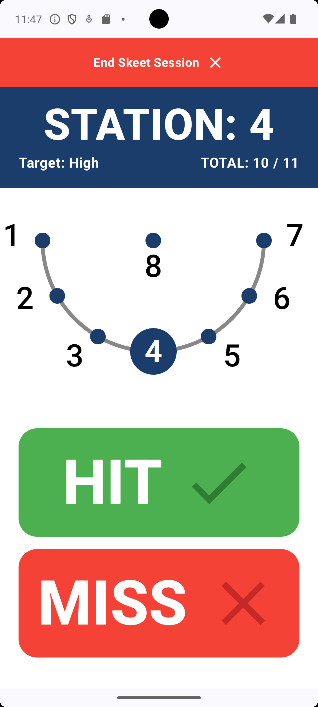
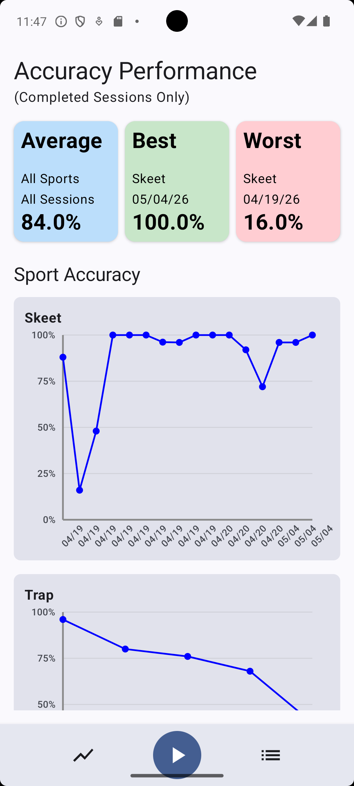

# Clay Shooting Tracker

A modern Android application built with Kotlin and Jetpack Compose to track and analyze clay shooting performance. This project was developed as a Capstone project for the University of Arizona's Applied Computing Program.

## 🚀 Features
- **Session Tracking**: Support for multiple shooting disciplines:
    - Skeet
    - Trap
    - Sporting Clays
    - Free Shoot
- **Detailed Analytics**: Track your progress over time with a dedicated Stats dashboard.
- **Session Management**: View history and drill down into specific session details.
- **Reactive UI**: Real-time updates using modern Android state management.

## 🛠 Tech Stack
- **Language**: Kotlin
- **UI Framework**: Jetpack Compose (Material 3)
- **Architecture**: MVVM + Repository Pattern
- **Database**: Room (Single Source of Truth)
- **State Management**: Unidirectional Data Flow (UDF) with `StateFlow`
- **Concurrency**: Kotlin Coroutines & Flow

## 🏗 Architecture & Standards
The project follows strict MVVM principles:
- **ViewModels**: Handle business logic and state transformation using `UiState` patterns.
- **Repositories**: Act as the boundary between the UI and data layers (DAOs).
- **Base Logic**: Shared session flows are encapsulated in `BaseSessionViewModel`.

## 📸 Screenshots
<p align="center">
  
  
</p>

## 📥 Getting Started
1. Clone the repository:
   ```bash
   git clone https://github.com/harry-h-tran/UofACapstone.git
   ```
2. Open the project in **Android Studio (Ladybug or newer)**.
3. Sync Project with Gradle Files.
4. Run on an emulator or physical device (API 24+ recommended).

## 📄 License
All rights reserved. This source code is provided for educational and viewing purposes only. See the [LICENSE](LICENSE) file for detailed terms and conditions.
